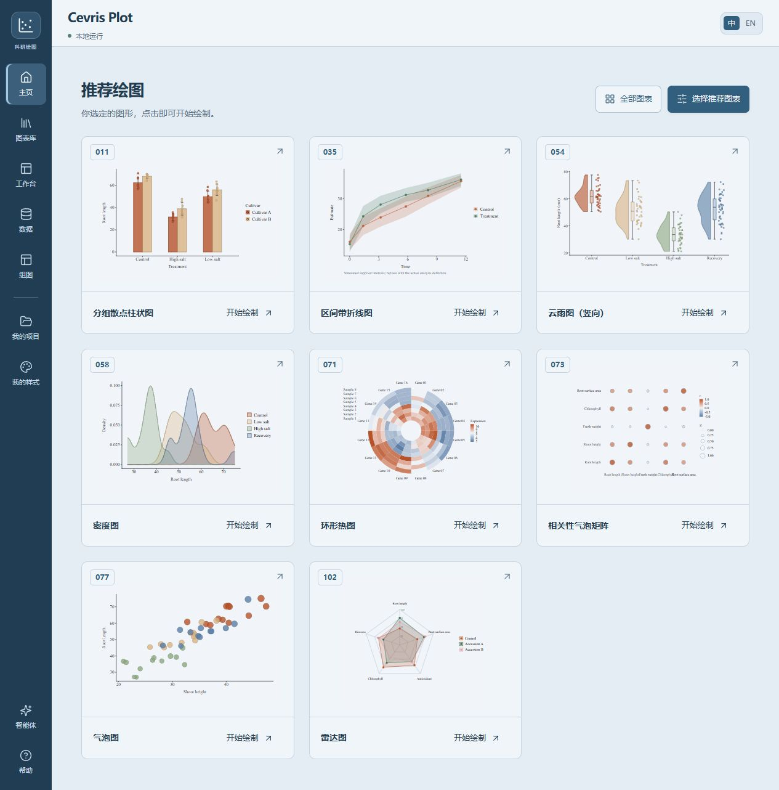

# Cevris Plot

An R-first scientific figure editor and agent Skill. Choose a chart, import data, adjust controls and export without writing code.

**105 R templates · 16 chart categories · Chinese / English UI · English demo data**



Version 0.7.1 is a preview release validated on Windows x64. See [release notes](RELEASE_NOTES.md) for limitations and known dependency advisories.

## Start locally

**[Download the Windows one-click installer](https://github.com/WAIWAIi7/cevris-plot/releases/download/v0.7.1/install-cevris-plot.cmd)** · [Portable ZIP](https://github.com/WAIWAIi7/cevris-plot/releases/download/v0.7.1/cevris-plot.zip) · [Release](https://github.com/WAIWAIi7/cevris-plot/releases/tag/v0.7.1)

Double-click the installer to verify and unpack the release, install dependencies, create a current-user Start Menu shortcut and open the editor. It installs under `%LOCALAPPDATA%\CevrisPlot\0.7.1`; afterwards search **Cevris Plot** in Start. First installation requires internet access, without administrator privileges. Use the ZIP option below to choose a different directory.

On Windows x64, extract the release ZIP and double-click `first-install.cmd`. It downloads Node.js, R and packages, builds and checks the app, then opens the editor automatically. Later, use `start.cmd` to open <http://127.0.0.1:47831/>. Afterwards manual data import, editing, project saving and export work offline. The local server must be running; a URL alone cannot start it. Other operating systems have not been validated.

The default page is the owner-curated home; open the chart library to browse every template. Select a chart to open its example in the editor, or download its CSV to see the expected data. The import dialog shows required fields and example rows before you choose CSV, TSV, TXT or XLSX. Preview the file, select its encoding or worksheet, then map columns to their meanings. See [data preparation instructions](DATA_FORMATS.md). Adjust appearance, text, axes, canvas and recipe-specific analysis options. The large canvas holds a smaller centered figure; use 25–300% zoom or Fit view. Zoom does not change export dimensions.

The UI language toggle does not modify data, labels or project contents. All built-in examples have English names, Times New Roman and default line width `0.5` in ggplot units. This is not a claim of 0.5 pt. Uploaded labels and identifiers are preserved.

## Agent → image → editor

An agent with local file and process access can read [SKILL.md](SKILL.md), inspect the data and create a JSON specification:

```json
{
  "input": "roots.csv",
  "recipeId": "bar",
  "name": "Root length",
  "context": "Independent plants in two treatments; root length in mm.",
  "mapping": {"group": "Treatment", "value": "Root length"},
  "labels": {"title": "", "y": "Root length (mm)"},
  "params": {"errorType": "sd", "showPoints": true}
}
```

```text
node scripts/figure.mjs inspect --input roots.csv
node scripts/figure.mjs draw --spec specification.json --out roots.png
node scripts/figure.mjs open --project roots.figure.json --browser false
```

`draw` delivers an actual R-rendered image, a `.figure.json` editable project and image metadata. `open` returns a direct editor link to a new local copy. The web app neither requests a model token nor sends data to a model. See [integration boundaries and reference coverage](COMPATIBILITY.md); ordinary chat clients cannot automatically execute local Skills.

## Color palettes

Version 0.6.3 adds 24 presets, for 28 total: 20 categorical, four sequential and four diverging. Open **Appearance → Browse all**. The library matches the active chart and normalization; volcano nonsignificant points stay gray. Choices persist in editable projects and image exports. Agents can use `node scripts/figure.mjs palettes` and a `"palette": "ocean-coral"` specification. See [palette definitions and limits](PALETTES.md).

## Raincloud plots

Three dedicated templates: vertical, horizontal and grouped panels. Supply one row per observation; grouped panels additionally require a series column. Density needs at least three varying measurements per group–series combination. Turn density off for constant groups. Cloud, box and raw points have separate controls; all use one measurement scale. Box quartiles use R type 7; whiskers reach observations within 1.5 IQR and outliers remain visible. Fixed-seed jitter only moves the categorical coordinate.

## Home, composition and R source (0.7.0)

The owner-curated homepage defaults to 011, 035, 054, 058, 071, 073, 077, 102, in that order. Browse all 105 numbered previews and choose exact templates; bar variants are 001–020. Personal selection order controls the home layout.

Compose up to 12 figures in a 1–4 column grid. Match appearance across the exact same recipe while preserving each dataset, mapping and labels; statistical settings and axis ranges are opt-in. Edit panels individually, adjust spacing and dimensions, and save an editable `.composition.json`.

All 105 recipes and compositions export a standalone `.R` file with data, settings and actual plotting code. With R, the required packages and fonts installed, it runs without the web server. Prism export has been removed. See [composition and source export](COMPOSITION.md).

## Data and export

Every chart has seeded, realistic synthetic data, a real R thumbnail and a declared data contract. User files are separate from examples. Original data, transformations, column mappings and styling are retained in projects. Save versions, restore history, and reuse styles on new data.

Exports: SVG, PDF, PNG, TIFF, standalone R source, editable single/composition project JSON, and a reproduction bundle containing data, parameters, expanded R source and version information. Statistical definitions are explicit: raw replicates for mean/error plots, supplied differential results for volcano/enrichment, actual PCA and right-censored Kaplan–Meier where declared. No invented P values or hidden imputation.

## Development

```text
npm ci
npm run build
npm test
npm run verify:r
node scripts/package.mjs
node scripts/package.mjs --source
```

R discovery uses `.runtime/R/bin/Rscript.exe` on Windows, or `FIGURE_RSCRIPT`; dependencies include ggplot2, jsonlite, svglite, systemfonts, ragg, MASS, survival and hexbin. The Windows installer configures them. `verify:r` regenerates every thumbnail and verifies actual exports. The distributable excludes `.data`, `.runtime`, installed dependencies and verification screenshots.

The source archive can be extracted into an independent GitHub repository. It includes MIT licensing, lockfiles, ignore rules and [contribution instructions](CONTRIBUTING.md). Packaging checks common credential patterns, personal paths and file sizes; this is not a complete security audit. It never uploads files or creates a remote repository. The package is marked private only to prevent accidental npm publication.

The production dependency audit still reports eight moderate transitive package entries, with zero high or critical entries. Publish as a development release with this finding disclosed; see [security status](SECURITY.md).

MIT license for project code. Third-party runtimes and packages retain their own licenses. No competitor code or screenshots are included in the distribution.
