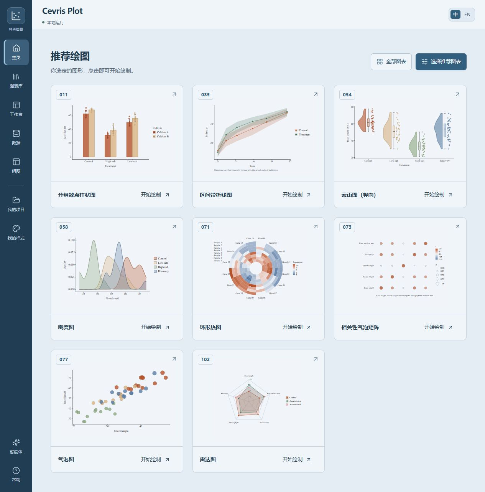

# Cevris Plot

[English](README.en.md) · [上传数据说明](DATA_FORMATS.md) · [平台兼容与参考覆盖](COMPATIBILITY.md)

本地科研绘图工具与智能体 Skill。中英文界面，R / ggplot2 主引擎，通过网页调节参数，不需要编写 R 或 Python。

**105 种 R 模板 · 28 套配色 · 云雨图与组图 · 可复现 R 源码 · 安装后手动绘图可离线使用**

当前为 0.8.1 预览版，已验证平台为 Windows x64。已知限制和依赖告警见 [发布说明](RELEASE_NOTES.md)。

[查看 0.8.1 安装修复验收](docs/RELEASE_CHECKS_080.md)

配色用法、完整名单和边界见 [PALETTES.md](PALETTES.md)。

## 运行

**[Windows 一键安装器](https://github.com/WAIWAIi7/cevris-plot/releases/download/v0.8.1/install-cevris-plot.cmd)** · [发布 ZIP](https://github.com/WAIWAIi7/cevris-plot/releases/download/v0.8.1/cevris-plot.zip) · [发布页](https://github.com/WAIWAIi7/cevris-plot/releases/tag/v0.8.1)

双击安装器可选择任意可写目录；或下载 ZIP，解压到目标磁盘，双击“首次安装.cmd”。发布包自带编译网页。安装后双击“启动科研绘图.cmd”或 start.cmd，即可打开本地网页。首次准备依赖需要联网，之后手动绘图、编辑和导出可以离线使用。

**0.8.1 改为文件部署**：官方 R 安装文件只解包、不执行，不依赖注册表或开始菜单权限；优先使用 Node/OpenSSL 下载，支持预置文件、已有 Node/R、安装日志和失败后重试。固定 2 GB 门槛已取消，改为根据缺少组件提示空间预算。开始菜单入口是可选项，默认无需创建。

受限环境、无窗口安装、离线准备、指定目录和磁盘占用说明见 [安装与修复指南](docs/INSTALLATION.md)。DSH 注册与豆包本地宿主接入见 [智能体宿主指南](docs/AGENT_HOSTS.md)。具体客户端需要具备本地文件和进程工具；不声称普通聊天网页可以直接安装本机软件。

网页采用“本机服务 + 浏览器”，数据在本地 .data，草稿保存在当前浏览器。网址本身不能启动服务；遇到拒绝连接请运行启动文件，并查看 .data/launcher.log、.data/server-error.log。安装日志为 .data/install.log。默认只手动启动；需要登录自启动时再使用相应脚本。移动应用或换电脑时，外部运行库路径和自启动入口需要重新指定；项目迁移使用 .figure.json / .composition.json 或复现包。

## 已实现

- 0.7.0 新增由用户选择的推荐主页：每个具体模板有固定编号和真实预览，柱状图 001–020。新增组图、同图型参数同步、独立组图草稿与可编辑组图文件；全部 105 种图形和组图均可下载独立 R 源码。已移除 Prism 导出。详见 [组图和 R 源码说明](COMPOSITION.md)。

- 分类配色随实际类别数自动适配，保留同名组颜色，新增类别沿用所选方案并补色；支持到100类，不声称大量颜色均能可靠区分。

- 0.6.3 新增24套配色，共28套：20套分类、4套连续渐变、4套双向发散。外观面板的“全部配色”可搜索并应用；自动按图形及标准化方式提供合适色阶，火山图保留中性灰。配色会随项目保存和导出。

- 0.6.2 精简常驻提示；导入前展示每种图的字段、真实示例和格式要求，支持文件预览确认、Excel工作表切换与编码重试。源码分发附独立忽略规则、上传指南与发布检查。
- 0.6.1 增强云雨图：独立分类，竖向、横向、分组三种模板；分别调节密度云、箱线、散点与组件间距，逐组校验密度条件。
- 默认进入推荐主页；完整图表库按图形分为16类，点击具体卡片进入编辑。默认推荐顺序：011、035、054、058、071、073、077、102；可在主页继续自定义。
- 中英文切换保存在本机，全部内置模拟数据与图中文字为英文；默认 Times New Roman。不会翻译或修改已导入数据。图形在大画布中央留白展示，支持25–300%缩放与适合窗口，视图缩放不影响导出大小。
- 六类编辑面板：外观、文字、坐标轴、画布、数据、计算。X/Y轴可分别调节字号、颜色、线宽、标题间距、刻度长度和显示；标题、图例、四边留白独立设置，使用折叠分组控制密度。
- 页面支持浏览器后退、Ctrl+S保存、非输入框中Ctrl+Z/Ctrl+Shift+Z撤销重做，图表库按“/”聚焦搜索。

- 105 种实际 R 模板（含视觉变体），0.6.0 新增18种：常规柱状变体、分组箱线/小提琴、环形柱、二值热图、相关气泡矩阵和环形热图。完整清单与输入要求见 [CATALOG.md](CATALOG.md)。0.4.0 新增20种：树状聚类热图、层次聚类树、散点矩阵、平行坐标、主成分双标、Kaplan–Meier生存分析、个体随访泳道、实验甘特、日历热图、方向玫瑰、等级丰度、个体稀释、基因组区间轨道、三阶段流向、加权弦图、华夫饼比例、水平发散条形、累计瀑布、配对差值估计和六边形分箱。
- 图表库支持中文、英文与常见缩写搜索，多关键词组合、图形分类、收藏、最近使用记录和空结果提示。收藏与最近记录保存在当前浏览器本机，不上传到服务器。
- 每种图有固定种子的模拟数据、R 绘制缩略图、输入说明和 CSV 下载。
- CSV/TSV/TXT/XLSX 导入、工作表选择、中文旧编码、列含义映射、缺失值提示、宽表转长表、筛选与原始数据恢复。单文件 10 MiB，最多 30,000 行、100 列。完整准备规则见 [数据上传说明](DATA_FORMATS.md)。
- 颜色、线宽、描边、散点、组间距、文字、画布、图例与配方专用设置。常用外观参数先即时更新 R 生成的 SVG，随后同步 R 精确图形；统计、坐标和布局改变由常驻 R 进程重新计算。连续输入只保留一个最新待绘制状态，避免旧任务积压，预览不再变暗闪烁。
- 无描边、加深、变浅；保留按组名称绑定的颜色。线宽默认 0.5 是 ggplot 尺度。
- 分组顺序可用按钮调整；连续坐标可输入上下限并恢复自动范围。轴标题间距、刻度长度、图例间距和图例色块尺寸均有控件。范围仅缩放画面，统计计算仍使用完整有效数据；柱形及面积图保留零基线。
- 撤销、重做、本机自动草稿、保存项目、不可变版本、历史恢复、可复用外观样式。外观样式不包含数据和分析参数。
- 实际 R 输出 SVG、PDF、PNG、TIFF；单图和组图支持独立 R 源码，导出可编辑项目、含原始文件/绘图数据/参数/R 程序/版本信息的复现包。
- 独立 Skill 与结构化 CLI，供智能体读取数据、准备项目，并直接打开已装入数据的编辑页。交接创建本机新副本，保留既有项目。详见 [SKILL.md](SKILL.md)。

## 数据与计算

PCA、相关系数、分布与汇总图进行其注明的 R 计算。火山、MA、富集与区间图使用已有分析结果；不把原始转录组计数自动冒充差异分析结果。不默认删除缺失值、不自动添加显著性星号。

ROC、PR与“生存曲线（已有估计）”使用用户已有的曲线点。新增 Kaplan–Meier 配方通过 R survival 接收一人一行的时间与0/1事件状态，实际计算右删失生存估计、95% log-log 置信带、删失标记及时间点之前的风险人数；不支持竞争风险、延迟入组或重复随访行，不自动进行组间检验。Bland–Altman 的一致性界限不是均值置信区间；配对差值估计图的均值差95% t区间要求独立配对与适当的差值分布假设。

SVG 采用可编辑文本，查看电脑需有相应字体；PDF 由 Cairo 生成。Windows 的 PNG/TIFF 也使用 Cairo；其他系统使用 ragg。实际设备写入元数据，不改变请求的字号、物理尺寸或DPI。默认字体为 Times New Roman，内置示例标签为英文。可选择本机其他字体；英文字体的中文字符可能使用设备的字形回退。

预览与导出共用同一 R 配方和参数。SVG 保留矢量与文本，但“本工具可继续参数编辑”的文件是 .figure.json，并非 Prism 原生文件。

即时反馈不意味着所有计算零耗时。线宽、组颜色、字体、点大小等会直接反馈；图例重排、坐标、核密度和数据变更仍需短暂 R 计算。同步提示消失后是精确图形；导出始终使用当前参数重新生成的 R 结果。首次加载环境和大型数据会更慢。渲染进程缓存已加载的包，两个工作进程隔离请求，固定随机种子不会因之前的编辑而改变。

配方遵循其输入边界：桑基图使用双阶段边；三阶段流向图需每行完整路径及数量，保留数量守恒。网络和弦图是无向正权重关系。雷达图需共同尺度指标；UpSet 计算精确交集。分类变异矩阵不把缺测当成未检出；等高线需完整规则网格。树状聚类使用欧氏距离并记录标准化与连接方法；PCA 双标图记录统一箭头展示倍率，不将箭头与得分轴混为一谈。稀释曲线是整数个体计数的无放回抽样解析期望，不随机丢弃数据、不外推。基因组区间采用0基半开区间，用户需统一参考基因组；日历空格保留缺测。比例网格明确标注舍入，方向玫瑰图用扇区面积编码频数。

## 验证

    node scripts/build.mjs
    node --test tests/*.test.mjs
    node scripts/verify-r.mjs

测试覆盖数据错误、缺失值、配对重复、颜色稳定性、表格变换、Excel 工作表、HTTP 完整流程、保存冲突、历史恢复、样式隔离、复现包重跑、坐标缩放不改变计算、已知测量与交集计数、持续输入合并及过期结果隔离。新增已知生存概率与风险人数、稀释期望、聚类高度、配对区间、累计收支、流量守恒、圆周与六边形计数、舍入和图表库筛选检查。R 检查逐一渲染105配方，并核对四种输出格式与参数变化。运行 node scripts/review-research.mjs 生成本轮20种新图的 SVG/PNG 审阅图；结果保存在 verification。

## 分发给其他智能体

运行 node scripts/package.mjs 生成 dist/cevris-plot.zip。将压缩包中的 cevris-plot 文件夹放入支持本地 Skill 的智能体目录，再运行该文件夹中的“首次安装.cmd”。安装包不含本机项目、用户数据、缓存或模型凭据；包含编译界面、R 配方、示例、Skill 和依赖锁文件。智能体通过 SKILL.md 与结构化命令操作；普通用户仍可直接双击启动。

## 后续范围

当前版本为 0.8.1，尚未实现数百图形、任意位置自由拖拽拼版、网页内模型对话、完整统计分析流水线或跨平台安装。后续按“配方 + 输入契约 + 示例 + 专用控件 + 导出验证”扩展。优先扩展 R 包；仅在 R 方案不能满足需求时增加其他引擎。

## GitHub 源码发布

运行 `node scripts/package.mjs --source` 生成 `dist/cevris-plot-source.zip`。解压后将 cevris-plot 文件夹内容作为独立仓库根目录。源码包含 MIT 许可、依赖锁、构建脚本、独立忽略规则和贡献说明；不含本地数据、运行环境、依赖目录和编译缓存。包生成器检查体积、个人目录路径与常见凭据模式，但不替代完整安全审计。它不会自动创建仓库或上传文件。

开发与验证步骤见 [CONTRIBUTING.md](CONTRIBUTING.md)。`package.json` 的 `private` 仅防止误发布到 npm，不限制在 GitHub 开源。新电脑首次安装仍需联网，尚未验收 macOS/Linux 安装。

当前依赖扫描仍有8条中等级别的间接依赖告警，未检出高危或严重级别；可作为开发版公开源码，不能宣称依赖审计完全通过。具体影响范围和已修复项见 [SECURITY.md](SECURITY.md)。

## 开发参考

科研呈现与数据保留规则借鉴 Scientific Agent Skills 的 scientific-visualization 工作流，具体实现使用 R。参考：Kassis, T., Agarwal, V., He, Y., Patel, D., & Brueckner, A. M. (2026). [Scientific Agent Skills: A Library of Procedural Knowledge for Research Agents](https://doi.org/10.48550/arXiv.2609.00065)。实现同时核对了 ggplot2 的[二维密度](https://ggplot2.tidyverse.org/reference/geom_density_2d.html)与[规则网格等高线](https://ggplot2.tidyverse.org/reference/geom_contour.html)官方说明。借鉴这些规则不构成期刊合规认证。

0.4.0 实现参考 R survival 的[survfit](https://stat.ethz.ch/R-manual/R-devel/library/survival/html/survfit.formula.html)、stats 的[hclust](https://stat.ethz.ch/R-manual/R-devel/library/stats/html/hclust.html)、vegan 的[rarefy 方法与输入约束](https://vegandevs.github.io/vegan/reference/rarefy.html)，以及 ggplot2 的[六边形计数](https://ggplot2.tidyverse.org/reference/geom_hex.html)。稀释期望公式在本项目R配方内实现，未引入vegan依赖。
